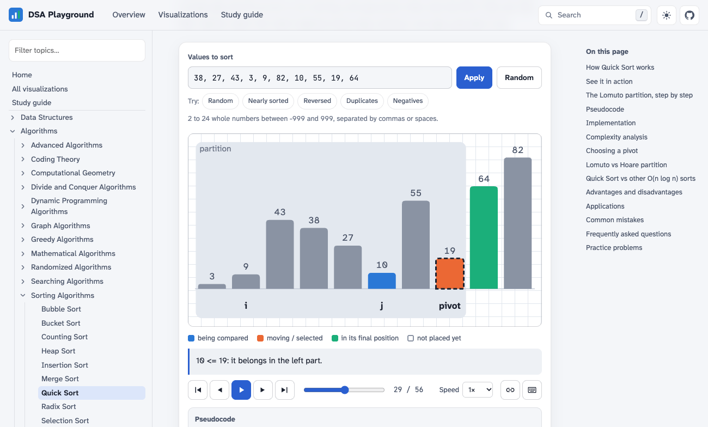

# Data Structures and Algorithms

[](https://github.com/snykk/dsa-playground/actions/workflows/ci.yml)
[](https://github.com/snykk/dsa-playground/releases/latest)
[](LICENSE)

A study repository of data structures and algorithms: 153 topics, each with an explanation and an implementation with unit tests in Python, C++ and Go. A companion web site, [DSA Playground](https://snykk.github.io/dsa-playground/), shows every topic as an article with the code side by side and animates every one of them step by step.

The explanations were checked against the code: for v0.7.1 an audit ran the code behind 3,654 claims in the READMEs and articles of all 153 topics, and corrected about 400 statements. The visualizations' TypeScript ports are checked against the Python code they animate.

<p>
  <a href="https://snykk.github.io/dsa-playground/">
    <picture>
      <source media="(prefers-color-scheme: dark)" srcset="docs/images/site-dark.png">
      
    </picture>
  </a>
</p>

## What Is Here

| Area | Topics | What it covers |
|------|--------|----------------|
| [Data Structures](Data_Structures/) | 47 | arrays, lists, stacks and queues, strings, hashing, trees, heaps, graph representations, caches and disjoint sets |
| [Algorithms](Algorithms/) | 81 | sorting, searching, divide and conquer, greedy, dynamic programming, graphs, strings, math, coding theory, geometry, randomized algorithms and backtracking |
| [Problem Patterns](Problem_Patterns/) | 13 | two pointers, sliding window, prefix sums, monotonic stacks and queues, binary search on the answer and other recurring patterns |
| [Complexity Analysis](Complexity_Analysis/) | 5 | Big-O, Big-Omega and Big-Theta, space complexity and amortized analysis |
| [Utilities](Utilities/) | 7 | optimization techniques, problem types, and contest templates in all three languages |

Each area, and each group inside it, has a README that lists its topics in reading order and compares them.

## Where to Start

- **Follow a path.** The [Study Guide](STUDY_GUIDE.md) orders every topic into phases, from complexity analysis and linear structures to advanced graphs and competitive programming. On the site, tick the topics you have finished; the ticks stay in your browser.
- **Browse an area.** Open an area above and read its topics in the order its README gives.
- **Watch it run.** On the [web site](https://snykk.github.io/dsa-playground/), run a visualization on your own input and step through it.
- **Practise.** 151 of the 153 articles end with three to five practice problems, from easy to harder, on LeetCode, CSES, Codeforces, AtCoder, Kattis or SPOJ, each checked on its judge.

## Inside a Topic

Every topic is a folder with the same layout, for example `Algorithms/Sorting/Quick_Sort/`:

```text
Quick_Sort/
  README.md                 intuition, a step-by-step trace, complexity, pitfalls, practice problems
  Python/                   quick_sort.py, quick_sort_test.py and a README for this implementation
  C++/                      quick_sort.cpp, quick_sort_test.cpp and a README
  Go/                       main.go, main_test.go, go.mod and a README
```

Python is the reference implementation of every topic. C++ and Go implement every topic too, covering each topic's core operations.

## Running the Tests

```text
make test          # every Python, Go and C++ test
make test-python   # one language at a time
make test-go
make test-cpp
make test-web      # the web site: unit tests, type check and build (needs Node)
make web-dev       # the web site locally, at http://localhost:4321/dsa-playground/
```

To run one topic's tests, start in its language folder. For Quick Sort, from the repository root:

```text
cd Algorithms/Sorting/Quick_Sort/Python && python3 -m unittest quick_sort_test
cd Algorithms/Sorting/Quick_Sort/Go && go test ./...
cd Algorithms/Sorting/Quick_Sort/C++ && g++ -std=c++17 -DIS_TEST_BUILD quick_sort_test.cpp -o quick_sort_test && ./quick_sort_test
```

`-DIS_TEST_BUILD` is how `make test-cpp` compiles the tests: it leaves out the demo `main` that some implementations have. Git ignores the compiled `*_test` binary.

You need Python 3, Go 1.24, a C++17 compiler, and Node 22 for the web site. CI runs the same suites on every pull request, plus the C++ tests under AddressSanitizer and UndefinedBehaviorSanitizer and a check of every README.

## The Web Site

The site lives in [web/](web/). It is an Astro site that turns this repository into pages: a hand-written article for every topic and every area, the Python, C++ and Go sources as tabs, and interactive visualizations whose TypeScript ports are checked against the Python code. On the site, `/` opens a search of the site, each article ends with its practice problems, and a player's link button copies a link to the step on screen. [web/README.md](web/README.md) explains how it is built.

## Contributing

- [CONTRIBUTING.md](CONTRIBUTING.md): the README templates, coding standards and test requirements.
- [RELEASING.md](RELEASING.md): how changes reach `master` through a release branch and a reviewed pull request.
- [CHANGELOG.md](CHANGELOG.md): what each release contains.

## License

[MIT](LICENSE)
